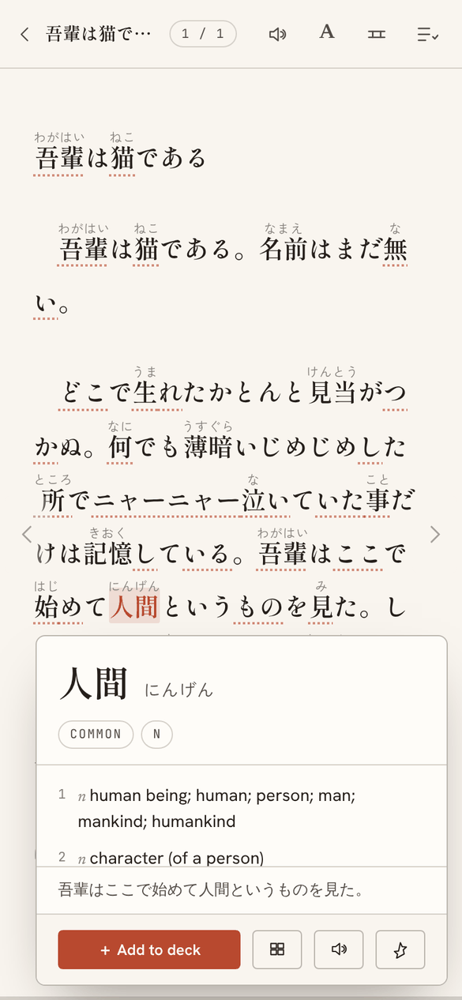
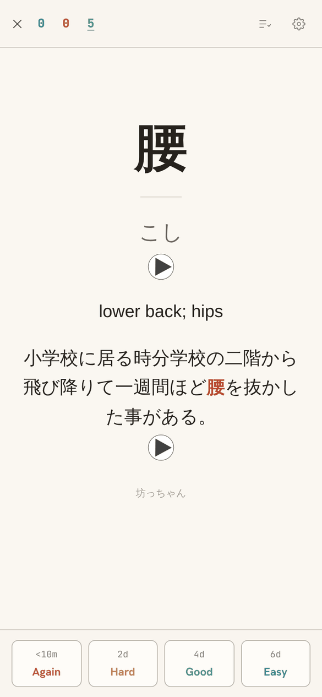
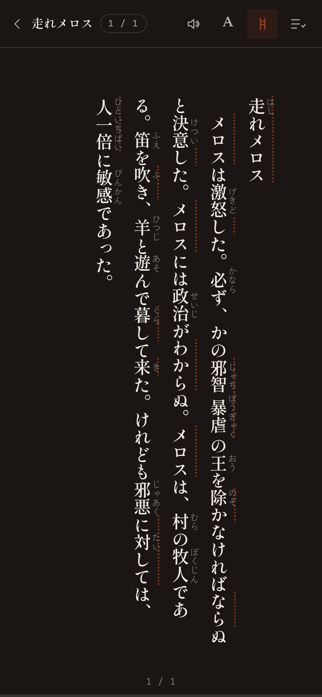
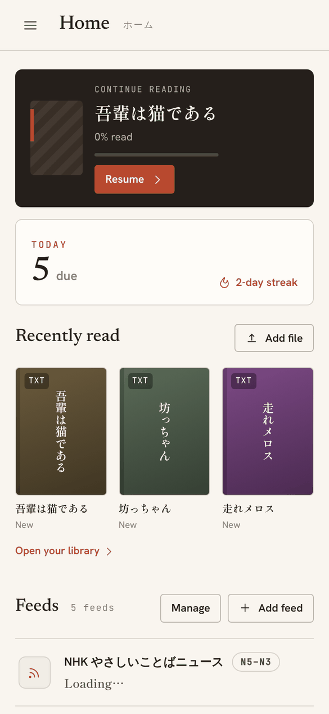
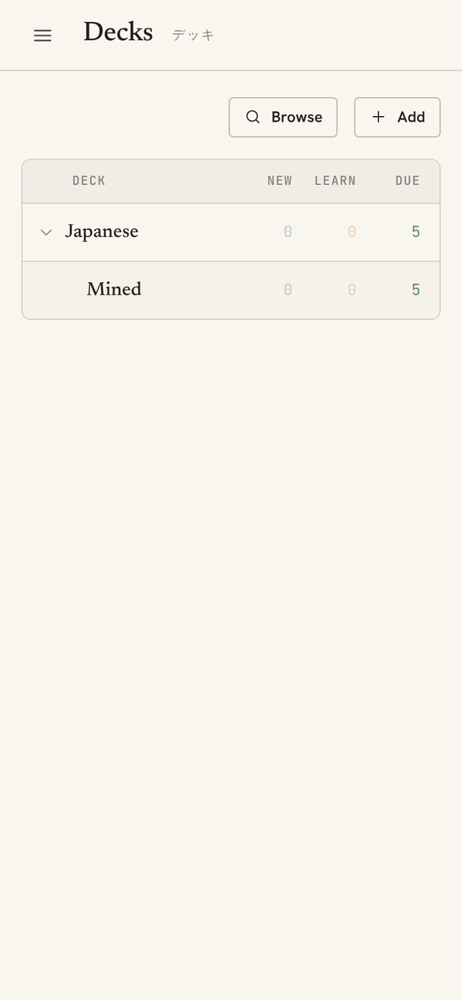
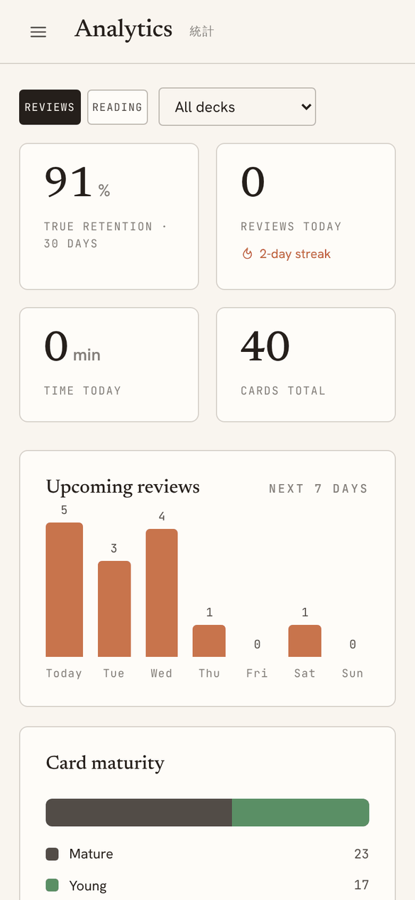

# GakuTaku

Learn Japanese by reading. GakuTaku is an Android app for reading Japanese books and news with
furigana and tap-to-look-up. You turn the words you don't know into flashcards with one tap, then
review them with the same scheduler Anki uses. It can replace Anki/AnkiDroid: it imports your
collection and keeps every card's schedule and history.

Everything stays **on your phone**. There are no accounts, no server and no tracking. A desktop
browser version works too, with a few limits (see [below](#on-a-desktop-browser)).

  
  
  

## Read

- **Books:** ePUB, PDF and TXT files from your phone. Shift_JIS/EUC-JP text files and Aozora Bunko
  markup are handled.
- **News:** NHK やさしいことばニュース and NHK's news categories are built in, and you can add any
  RSS or Atom feed.
- **Furigana** over every word, only over harder kanji (N3 and above), or turned off.
- **Tap any word** for its dictionary entry: JMdict meanings, names from JMnedict, and kanji
  readings from KANJIDIC. Conjugated forms are looked up as their dictionary form. The dictionary
  is built into the app and works offline.
- **Vertical (縦書き) or horizontal** text, paged or scrolling, with adjustable text size and line
  width.
- **Words you don't have a card for are underlined**, so you can see what's new on each page.
- **Read aloud** with the phone's Japanese voice, plus bookmarks, sentence highlights and a table of
  contents. Your place is saved in every book.

## Mine words

One tap on **Add to deck** in the dictionary popup makes a flashcard. Each card holds the word, its
reading and meaning, and the sentence you found it in (with the word in bold) and where it came from.
On Android it also gets two recordings: a native speaker saying the word (from JapanesePod101) and
the sentence read by the phone's Japanese voice. **Review mined** studies the words from your current
reading session straight away.

## Review

  
  
  

- **Anki's scheduler, ported:** learning steps, FSRS-6 or SM-2, interval fuzz, daily limits and
  sibling burying behave as they do in Anki, so your due counts match.
- **Import your Anki collection** (`.colpkg`) or shared decks (`.apkg`). Scheduling, review history,
  deck options and media all come across. You can export decks back out as `.apkg`.
- **Cards look as they do in Anki,** with the note type's own styling and scripts, audio, cloze and
  type-in answers.
- **AnkiDroid-style reviewing:** tap zones and swipes you assign yourself, undo, flags, mark, bury,
  suspend, set a due date, edit the note mid-review, card info, an answer timer and card zoom.
- **Deck tools:** deck options presets, the FSRS optimizer (trains your parameters on your own
  review history), filtered decks and Custom Study, a card browser with Anki's search syntax, and a
  note-type editor.
- **Analytics:** Anki's statistics graphs for one deck or for everything, an activity calendar, and a
  Reading tab with the chapters, articles, characters and time you've read.
- **Daily reminder** (Android) that says how many cards are due.
- **Themes:** follow the phone, light, dark or true black, with a choice of accent colour and a
  Home wallpaper.

## Your data

- **Back up now** (Settings) saves one file containing your cards, review history, media, books and
  settings. On Android it opens the share sheet, so you can save it to Drive or Files or send it to
  another device. **Restore** puts everything back.
- The app also keeps **automatic daily backups** of your cards and history (the last five) inside
  the app.
- Uninstalling the app **deletes its data**, so back up first.

## Install on Android

Every merge to `main` builds a signed APK and publishes it as a
[GitHub Release](../../releases). Install it with **[Obtainium](https://github.com/ImranR98/Obtainium)**
(add this repository's URL) so updates arrive automatically, or download the APK from the latest
release.

Every release is signed with the same key, so updates install over the previous version and keep your
data.

### On a desktop browser

`npm run dev` runs the same app in a desktop browser. Reading, reviewing, import and backups all
work. The browser blocks most news sites from being read by another site, so most feeds only load in
the Android app. Mined cards don't get recordings there either; they read the word and sentence aloud
at review time instead.

## Credits

The dictionary uses [JMdict, JMnedict and KANJIDIC](https://www.edrdg.org/) from the Electronic
Dictionary Research and Development Group, under their
[licence](https://www.edrdg.org/edrdg/licence.html), converted by
[jmdict-simplified](https://github.com/scriptin/jmdict-simplified). Words are split with
[kuromoji.js](https://github.com/sglkc/kuromoji.js). The scheduler is a port of
[Anki](https://github.com/ankitects/anki), and the FSRS optimizer is a port of
[fsrs-rs](https://github.com/open-spaced-repetition/fsrs-rs). The full list is in Settings →
Credits.

Screenshots show the openings of 吾輩は猫である, 坊っちゃん and 走れメロス (public domain), with
words mined from them and a few weeks of reviews.

## Development

See **[DEVELOPMENT.md](DEVELOPMENT.md)** for building the app and the Android APK, the dictionary
pipeline, and notes on how the code is organised.
